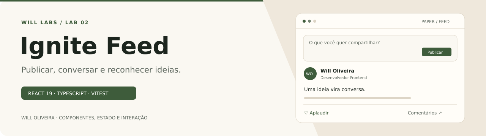
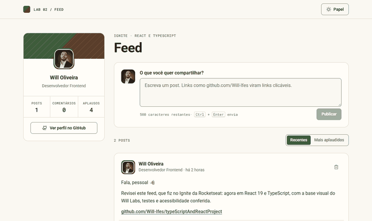

<p align="center">
  
</p>

# Feed de publicações · React e TypeScript

Um feed com posts, comentários e aplausos, feito no Ignite da Rocketseat para estudar React, TypeScript e componentização. Na revisão ganhou stack atual, funcionalidades de verdade, testes e a linguagem visual do [Will Labs](https://github.com/Will-Ifes/will-labs).

**React 19 · TypeScript · Vite 8 · Vitest** · [Ver online](https://will-ifes.github.io/typeScriptAndReactProject/)

<p align="center">
  
</p>

## O que dá para fazer

- **Publicar** um post de até 500 caracteres. URLs e domínios como `jane.design/doctorcare` viram links que abrem em outra aba.
- **Comentar** em qualquer post, com seu nome, sua foto do GitHub e o horário real.
- **Aplaudir** posts e comentários. O aplauso alterna (aplaudir de novo desfaz) em vez de somar sem limite.
- **Apagar** os seus posts e comentários, com **Desfazer** no aviso.
- Ordenar por **Recentes** ou **Mais aplaudidos** e acompanhar seus números no perfil.
- <kbd>Ctrl</kbd> + <kbd>Enter</kbd> envia; tema **Papel** ou **Floresta**.

O feed fica salvo neste navegador. Na primeira visita aparecem dois posts de exemplo.

## O que mudou na revisão

| Antes | Depois |
| --- | --- |
| React 18, Vite 3, TypeScript 4 e `phosphor-react` (descontinuado) | React 19, Vite 8, TypeScript 6 `strict` e `@phosphor-icons/react`; 0 vulnerabilidades |
| Comentário usava o próprio texto como `key`: dois iguais colidiam e apagar um apagava todos | `id` com `crypto.randomUUID()` e reducer tipado em [`useFeed`](src/hooks/useFeed.ts) |
| Todo comentário saía com o mesmo autor e o horário fixo "Cerca de 1h atrás" | Autor do perfil do GitHub e horário relativo que se atualiza |
| Aplauso somava sem limite e zerava ao recarregar | Aplauso que alterna, salvo com o resto do feed |
| Posts fixos no código, links com `href="#"` | Compositor de posts e links reais detectados no texto |
| `date-fns` só para datas | `Intl.RelativeTimeFormat` nativo, uma dependência a menos |
| Workflow em `ubuntu-18.04` e Node 14 publicando a pasta errada (`build`) | Workflow atual que roda lint, testes e build e publica `dist` no GitHub Pages |
| `console.log` no Avatar, `publisheAt`, capa sem `alt` | Removidos e corrigidos; capa decorativa com a diagonal da marca |
| Sem testes | 13 testes com Vitest e Testing Library |

**Validação:** axe-core sem violações nos dois temas em 375, 768 e 1366 px, com comentário novo e aplauso marcados.

## Por dentro do código

| Código | Responsabilidade |
| --- | --- |
| [`src/hooks/useFeed.ts`](src/hooks/useFeed.ts) | Reducer do feed (publicar, comentar, aplaudir, apagar e restaurar) e persistência. |
| [`src/utils/conteudo.ts`](src/utils/conteudo.ts) | Divide o texto em parágrafos e encontra links. |
| [`src/utils/tempo.ts`](src/utils/tempo.ts) | Tempo relativo em português com `Intl`. |
| [`src/components/Compositor`](src/components/Compositor) | Campo usado para posts e comentários, com contador e atalho. |
| [`src/components/Post`](src/components/Post) e [`Comentario`](src/components/Comentario) | Exibição, ações e permissões de quem pode apagar. |
| [`src/styles/tokens.css`](src/styles/tokens.css) | Tokens de cor, espaço, raio e tipografia baseados no Will Labs. |

## Executar localmente

Requer Node.js 20.19 ou superior.

```bash
git clone https://github.com/Will-Ifes/typeScriptAndReactProject.git
cd typeScriptAndReactProject
npm install
npm run dev
```

| Comando | O que faz |
| --- | --- |
| `npm run dev` | Servidor de desenvolvimento |
| `npm test` | Testes com Vitest |
| `npm run lint` | ESLint |
| `npm run build` | Typecheck e build de produção |

---

Mantido por **Will Oliveira** · [Perfil](https://github.com/Will-Ifes) · [LinkedIn](https://www.linkedin.com/in/wildemberg-de-jesus-oliveira/)
